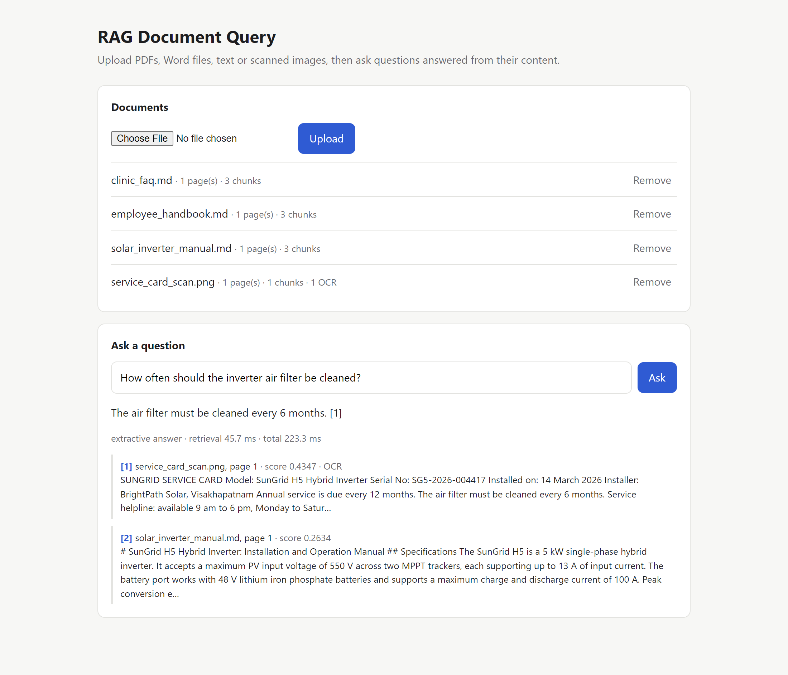
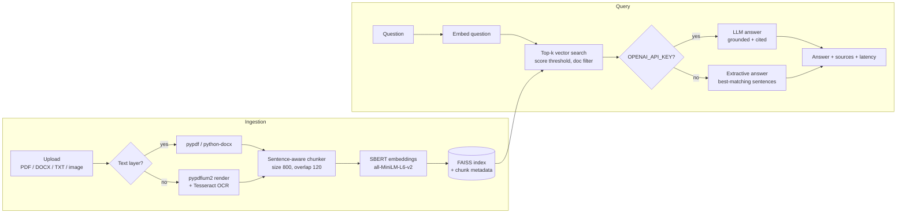
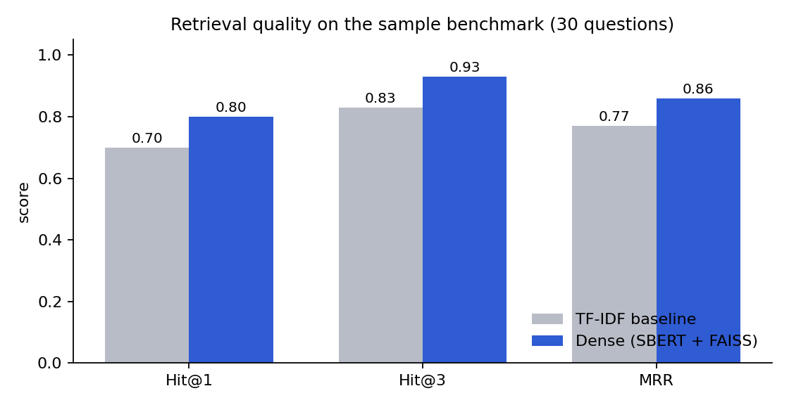
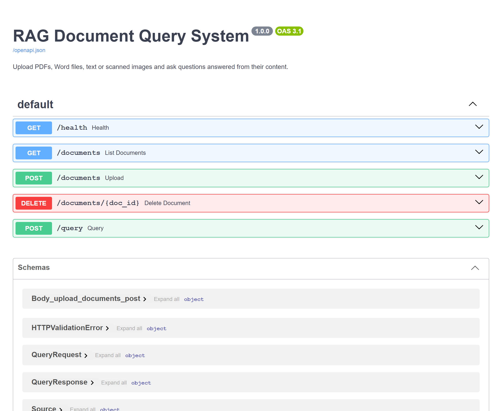

# RAG Document Query System

**Ask questions about your documents (PDFs, Word files, text, even scanned images) and get grounded answers with page-level citations.**




*The answer above comes from `service_card_scan.png`, a scanned image with no text layer, read with OCR, then embedded and retrieved.*

## Features

- **Multi-format ingestion**: PDF, DOCX (including tables), TXT/Markdown, and PNG/JPG/TIFF images.
- **Automatic OCR fallback**: PDF pages with no usable text layer are rendered and run through Tesseract, so scanned documents work too.
- **Sentence-aware chunking** with configurable size and overlap, keeping page numbers for citations.
- **Dense retrieval** with SBERT embeddings in a persistent FAISS index (`IndexIDMap2` over inner product on normalised vectors), with per-document add, delete and filtering.
- **Grounded answers**: with an OpenAI key, a GPT model answers strictly from retrieved excerpts with inline `[n]` citations. Without a key, an extractive answerer picks the sentences closest to the question, so the system runs fully offline.
- **REST API** with Swagger docs, plus a minimal web UI.
- **Benchmark script** that compares dense retrieval against a TF-IDF baseline.

## Architecture



## Retrieval benchmark

`scripts/evaluate.py` indexes the sample documents in `data/sample/` and runs 30 labelled questions from `eval/questions.json`, many of them paraphrased so they don't share keywords with the answer. A question counts as a hit when a retrieved chunk contains the expected answer span.



| Retriever | Hit@1 | Hit@3 | MRR | Latency / query (CPU) |
|---|---|---|---|---|
| TF-IDF baseline | 0.70 | 0.83 | 0.77 | 0.6 ms |
| Dense (SBERT + FAISS) | **0.80** | **0.93** | **0.86** | 26.0 ms |

Dense retrieval finds the right passage in the top 3 for 93% of questions, compared with 83% for keyword matching. Most of the gain comes from paraphrased questions such as *"How long can I park for free?"*. Reproduce it with:

```bash
python scripts/evaluate.py --k 3
```

## Quick start

```bash
git clone https://github.com/madhumanasa01/RAG-Document-Query-System.git
cd RAG-Document-Query-System
python -m venv .venv && source .venv/bin/activate   # Windows: .venv\Scripts\activate
pip install -r requirements.txt
cp .env.example .env            # optional: add OPENAI_API_KEY
uvicorn app.main:app --reload
```

Open http://localhost:8000 for the UI or http://localhost:8000/docs for Swagger.

OCR needs the Tesseract binary on your PATH (`apt install tesseract-ocr`, `brew install tesseract`, or the Windows installer).

Or run it with Docker:

```bash
docker build -t rag-docs .
docker run -p 8000:8000 -e OPENAI_API_KEY=sk-... rag-docs
```

## API

| Method | Endpoint | Description |
|---|---|---|
| `POST` | `/documents` | Upload a file (multipart `file`). Returns doc id, pages, OCR pages, chunks |
| `GET` | `/documents` | List indexed documents |
| `DELETE` | `/documents/{doc_id}` | Remove a document and its vectors |
| `POST` | `/query` | `{"question": "...", "top_k": 5, "doc_ids": [...]}` returns the answer, sources and timings |
| `GET` | `/health` | Index stats and whether LLM mode is enabled |

```bash
curl -F "file=@data/sample/solar_inverter_manual.md" localhost:8000/documents
curl -X POST localhost:8000/query -H "Content-Type: application/json" \
     -d '{"question": "What does error E12 mean?"}'
```

```json
{
  "answer": "E12 means the battery communication cable is disconnected; check the CAN connection between the battery and the inverter. [1]",
  "mode": "extractive",
  "sources": [{"ref": 1, "filename": "solar_inverter_manual.md", "page": 1, "score": 0.45, "ocr": false, "excerpt": "..."}],
  "retrieval_ms": 23.8,
  "total_ms": 111.6
}
```



## Project structure

```
app/
├── main.py         FastAPI routes and app lifecycle
├── parsers.py      PDF / DOCX / text / image parsing with OCR fallback
├── chunker.py      Sentence-aware chunking with overlap
├── embeddings.py   SentenceTransformer wrapper
├── store.py        Persistent FAISS vector store with metadata
├── generator.py    LLM-grounded or extractive answer generation
└── config.py       Settings from environment / .env
scripts/evaluate.py Retrieval benchmark (dense vs TF-IDF)
static/index.html   Web UI
tests/              Unit and API tests (no model download needed)
data/sample/        Sample documents used by the benchmark
data/scanned/       Scanned image for trying OCR
```

## Tests

```bash
pytest -q
```

The tests use a deterministic hashing embedder, so they run in about 2 seconds without downloading a model.

## License

MIT
